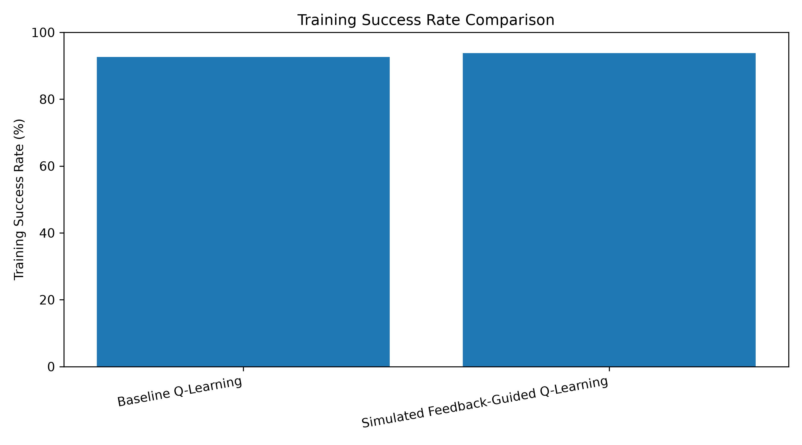
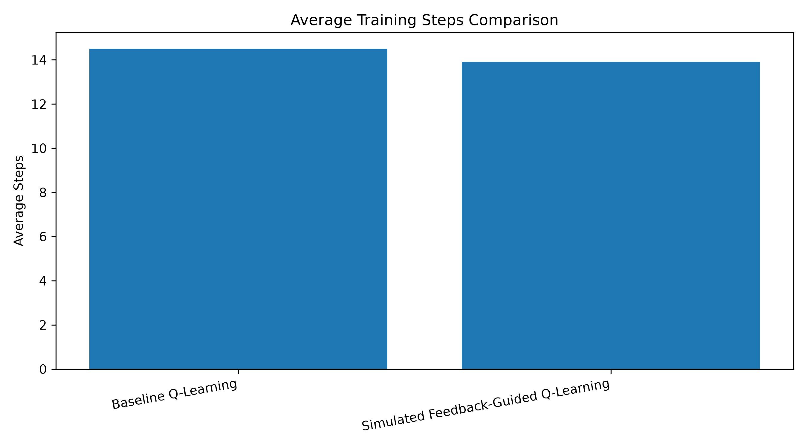
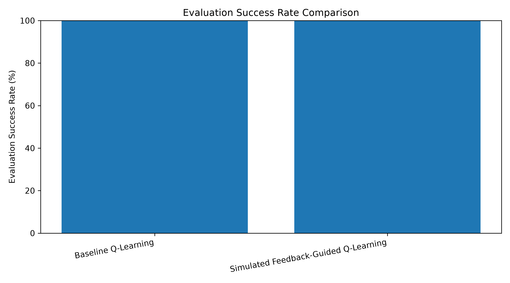

# Human-Guided Reinforcement Learning Using Q-Learning

## Project Overview

This project demonstrates a Human-Guided Reinforcement Learning approach using the Q-Learning algorithm. It compares standard Q-Learning with a feedback-guided approach in a grid-world environment.

The agent learns to navigate from a starting position to a goal by selecting actions and receiving rewards.

## Objectives

- Implement a baseline Q-Learning algorithm.
- Simulate human feedback to guide the agent's learning.
- Compare training performance between both approaches.
- Evaluate success rates and average steps.
- Visualize experimental results using graphs.

## Technologies Used

- Python
- Matplotlib
- CSV
- Q-Learning
- Reinforcement Learning

## Project Structure

```text
Human_Guided_RL/
├── main.py
├── q_learning_backup.py
├── human_feedback.py
├── experiment.py
├── plot_results.py
├── experiment_results.csv
├── training_success_comparison.png
├── training_steps_comparison.png
├── evaluation_success_comparison.png
└── README.md
```

## Methodology

### 1. Baseline Q-Learning

The agent learns a policy through rewards received from the environment without additional human guidance.

### 2. Feedback-Guided Q-Learning

The agent receives simulated feedback that influences its learning process. The experiment uses distance-based simulated guidance, not feedback collected from real human participants.

### 3. Experimental Evaluation

Both approaches are evaluated using training success rate, average training steps, evaluation success rate, and average evaluation steps.

## Experimental Results

The experiment results are stored in `experiment_results.csv`.

The following graphs visualize the comparison:

### Training Success Rate



### Average Training Steps



### Evaluation Success Rate



## How to Run

1. Install Python 3.
2. Install Matplotlib:

   ```bash
   python -m pip install matplotlib
   ```

3. Run the experiment:

   ```bash
   python experiment.py
   ```

4. Generate comparison graphs:

   ```bash
   python plot_results.py
   ```

## Conclusion

This project compares baseline Q-Learning with a simulated feedback-guided learning approach in a grid-world environment. The results help analyze how simulated guidance affects learning performance.

**Note:** Results are specific to the implemented environment and experimental configuration. They should not be interpreted as proof that real human feedback always improves reinforcement learning.
## Browser-Based Human Feedback Interface

The project includes a Flask-based web interface that allows a user to guide a Q-Learning agent in a grid-world environment.

### Features

- Interactive grid-world navigation.
- User feedback through **Good Action** and **Bad Action** buttons.
- Q-value updates based on user-provided feedback.
- Episode reset and learning restart controls.
- Performance statistics and recent episode results.
- Feedback logging to CSV for analysis.

### Run the Web Application

Install Flask and Matplotlib:

```bash
python -m pip install flask matplotlib
```

Start the Flask application:

```bash
python app.py
```

Open this address in your browser:

```text
http://127.0.0.1:5000
```

Keep the terminal running while using the interface. This is a local development application.

## Experiments with Random Obstacle Layouts

The project also includes experiments comparing baseline Q-Learning with simulated feedback-guided Q-Learning across multiple random obstacle layouts and random seeds.

Files:

- `random_obstacle_experiment.py` — runs the random-obstacle experiments.
- `comparison_experiment.py` — compares learning performance across independent seeds.
- `plot_random_obstacle_results.py` — generates experiment comparison graphs.
- `random_obstacle_results.csv` — stores experiment summary results.
- `random_obstacle_learning_curves.csv` — stores learning-curve data.
- `random_obstacle_training_comparison.png` — training success comparison.
- `random_obstacle_evaluation_comparison.png` — evaluation success comparison.
- `comparison_learning_curves.png` — learning-curve comparison.
- `comparison_success_rates.png` — success-rate comparison.

Run the random-obstacle experiment:

```bash
python random_obstacle_experiment.py
```

Generate its graphs:

```bash
python plot_random_obstacle_results.py
```

**Research limitation:** The experimental feedback-guided method uses simulated distance-based guidance. The browser interface accepts actual user feedback, but these are separate experimental setups. Results from simulated feedback should not be described as results from real human participants.
## Research Findings and Limitations

### Key Findings
- Compared baseline Q-Learning with simulated feedback-guided Q-Learning.
- Evaluated learning performance across multiple random obstacle layouts and random seeds.
- Generated graphs to compare training success rates and evaluation success rates.
- Recorded experiment results in CSV files for reproducibility.

### Limitations
- The feedback-guided method uses simulated distance-based guidance, not feedback collected from human participants.
- Results depend on the environment, obstacle layouts, random seeds, and experimental settings.
- Similar evaluation success rates do not necessarily indicate that both methods learn equally efficiently.

### Future Improvements
- Test more random seeds and obstacle layouts.
- Compare learning speed and average steps with appropriate statistical analysis.
- Implement a more realistic human-feedback mechanism.
- Evaluate the method in more complex environments.
